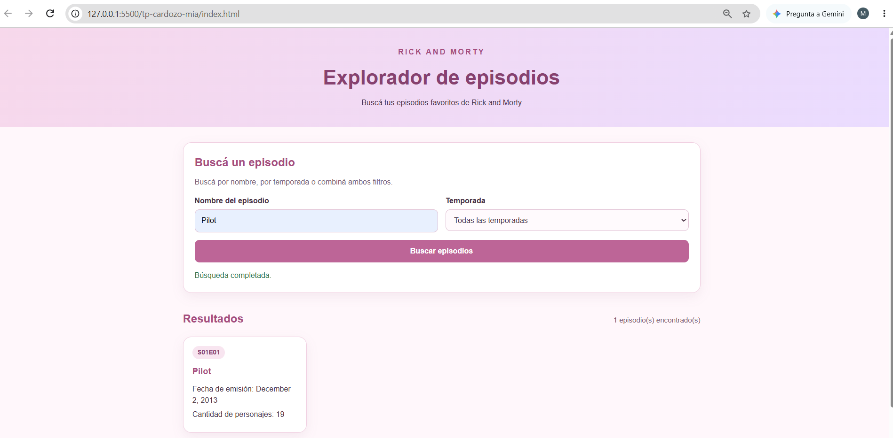

# Explorador de episodios - Rick and Morty

**Estudiante:** Mia Cardozo  
**Asignatura:** Fundamentos de Desarrollo Web  
**Variante:** C - Episodios (último dígito de cédula: 8)

## Descripción
Página web de una sola pantalla que consulta la API REST de Rick and Morty. Permite buscar episodios por nombre y filtrar por temporada. Los resultados se muestran en tarjetas con nombre, código, fecha de emisión y cantidad de personajes.

## Tecnologías utilizadas
HTML5 semántico, CSS Grid, Flexbox, variables CSS, diseño responsive y JavaScript ES6+ (Fetch, async/await, DOM y localStorage).

## API utilizada
https://rickandmortyapi.com/api/episode

## Cómo ejecutar
Abrir el archivo `index.html` con Live Server desde Visual Studio Code.

## Captura de pantalla
